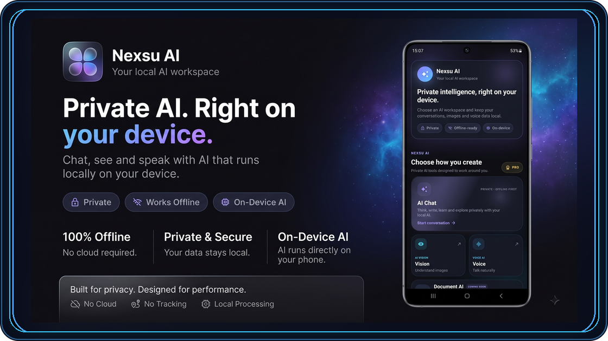
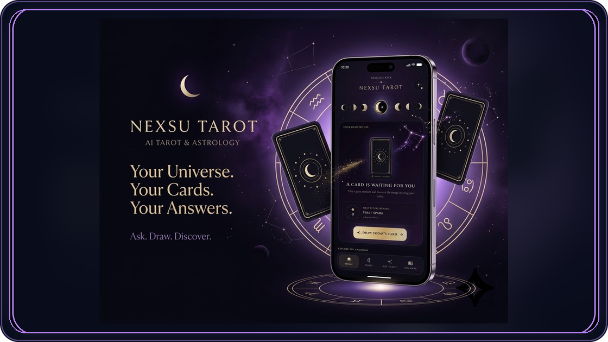

 

**3+ years shipping mobile software** &nbsp; • &nbsp; **Contributed to apps with 1M+ downloads** &nbsp; • &nbsp; **Independent app creator**

 

 

### 👋 Hey, I'm Khiem

I’m a **Mobile Software Engineer** building reliable, polished apps across **Flutter, native Android and iOS integration**. My work spans **real-time fintech**, **digital identity**, **AI/ML**, **connected devices** and **consumer apps**. I enjoy the hard parts behind great mobile experiences: architecture, data streams, native integrations, security, performance and shipping.

> **Beyond the public repos:** Most of my professional code is proprietary. Below are products I independently shipped and selected engineering experience.

---

### ✦ Engineering across domains

 

### 🚀 Featured apps · built & shipped independently

<table>
<tr>
<td width="50%" valign="top" align="center">

<h3>✦ Nexsu AI</h3>
<strong>Private intelligence. Right on your device.</strong>  
On-device language models, offline chat, voice AI and image understanding — designed around privacy and performance.  
<code>Flutter</code> <code>On-device LLM</code> <code>Voice</code> <code>Vision</code>  

</td>
<td width="50%" valign="top" align="center">

<h3>☾ Nexsu Tarot</h3>
<strong>Your universe. Your cards. Your answers.</strong>  
A polished AI-powered Tarot and astrology experience with interactive readings, custom UI and production monetization.  
<code>Flutter</code> <code>Firebase</code> <code>AI</code> <code>Subscriptions</code>  

</td>
</tr>
</table>

> 🔒 **Private source, public products.** Product cards link to app listings, not proprietary code.

---

### 💼 Where I've built

| | Experience | Engineering focus |
|:--|:--|:--|
| **01** | **Anfin** · Mobile Developer · 2025–2026 | Real-time trading, gRPC unary/streaming, orderbook and price charts, transaction security, T-OTP and biometrics. |
| **02** | **CoolDev** · Mobile Developer · 2024–2025 | AI assistants, computer vision, DJI drone controls, speech, screen mirroring and consumer apps reaching **500K–1M+ downloads**. |
| **03** | **Gtel Mobile** · Mobile Developer · 2023–2024 | Reusable Android/Flutter **NFC eKYC SDKs**, MRZ, face verification, AWS Rekognition and bank/e-wallet integration flows. |

---

### 🏢 Production apps · contributed at work

> Selected **company-owned products** I contributed to as a Mobile Developer. My work focused on the features described below; these are **team products, not independently owned or open-source projects**.

<table>
<tr>
<td width="50%" valign="top">

#### 📈 AnfinX · Anfin

**Fintech / Commodity Trading**

Built real-time mobile trading experiences, including **gRPC unary & streaming**, order placement and modification, live **orderbook / price charts**, and transaction-security workflows.

`Flutter` `gRPC` `Streaming` `T-OTP` `Biometrics`

</td>
<td width="50%" valign="top">

#### 📡 iZOTA · Gtel Mobile

**Telecommunications / Digital Services**

Contributed to **OTT integration** for the iZOTA telecom platform. At Gtel, also developed reusable **NFC eKYC SDKs** and identity-verification flows for mobile integrations.

`Android` `Flutter` `OTT` `NFC` `eKYC`

</td>
</tr>
</table>

#### ✨ CoolDev · AI, drones & connected experiences

| Product | Domain | My contribution |
|:--|:--|:--|
| **[Voice AI Assistant for Seri](https://play.google.com/store/apps/details?id=com.smartremote.homepodsiri)** · 1M+ downloads* | AI / Voice / Productivity | Voice messaging, translation, note-taking and AI chatbot integrations. |
| **[Fly Go 4: Drone Camera Remote](https://play.google.com/store/apps/details?id=com.smartremote.djiflydrone)** · 1M+ downloads* | IoT / Drone Control | Drone gimbal control via mobile and remote controllers, including legacy-device support. |
| **[Hidden Camera Detector Cam Spy](https://play.google.com/store/apps/details?id=com.smartremote.camera.detector)** · 10K+ downloads* | Computer Vision / Security | Real-time object-recognition features for hidden-camera detection. |
| **[CarLink – Car Play Connect](https://play.google.com/store/apps/details?id=com.cooldev.carplay.castcar)** | Automotive / Screen Mirroring | Mobile-to-car screen-mirroring functionality for compatible displays. |

*Download figures are the approximate product milestones stated in my CV, not downloads personally generated. Public store listings and branding may change over time.

---

### 🧰 My engineering toolkit

**Mobile platforms & languages**

**Architecture & app state** — Clean Architecture · MVVM · BLoC · Riverpod · GetX · Coroutines · Flow · Dependency Injection · Repository Pattern

**Networking & real-time** — REST APIs · gRPC Unary & Streaming · WebSocket · real-time synchronization · push notifications

**Mobile security & SDKs** — NFC · eKYC · MRZ · biometrics · OTP/T-OTP · digital signing · Android/Flutter SDK development

**AI, multimedia & connected devices** — On-device LLM · computer vision · ML Kit · AWS Rekognition · speech-to-text · DJI SDK · screen mirroring

**Cloud, shipping & growth** — Firebase · Firestore · Git · Google Play Billing · in-app purchases · subscriptions · Google AdMob · Pangle

---

### ⚡ A little more than code

- I like turning difficult mobile constraints into simple experiences — **offline execution, real-time data, native device APIs and privacy**.
- I care about **shipping**, not just prototypes: architecture, testing, performance, debugging and release readiness.
- I built **Nexsu AI** and **Nexsu Tarot** independently and keep their commercial source private.

 

  
<strong>Let's build something worth shipping.</strong> 
Mobile engineering · On-device AI · Production-minded development  

