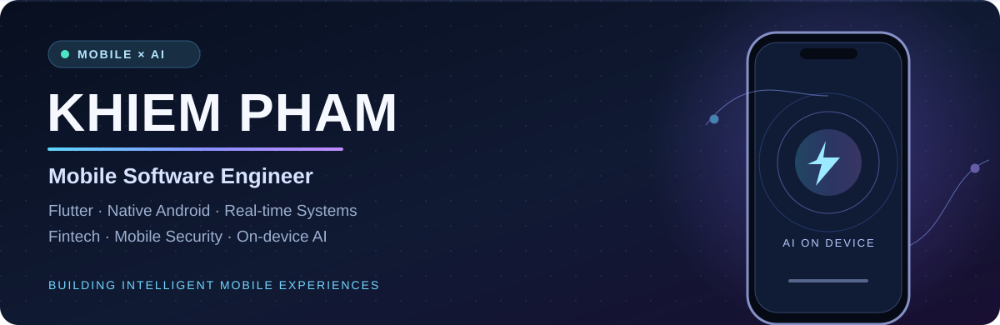
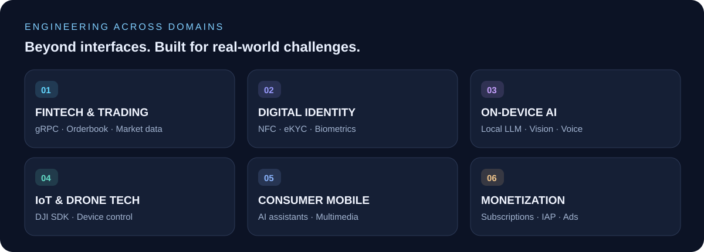
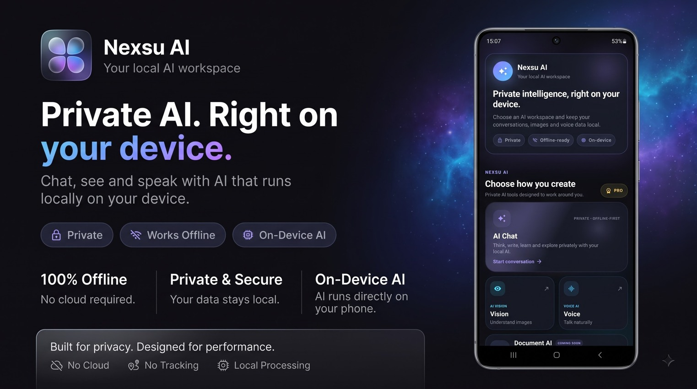
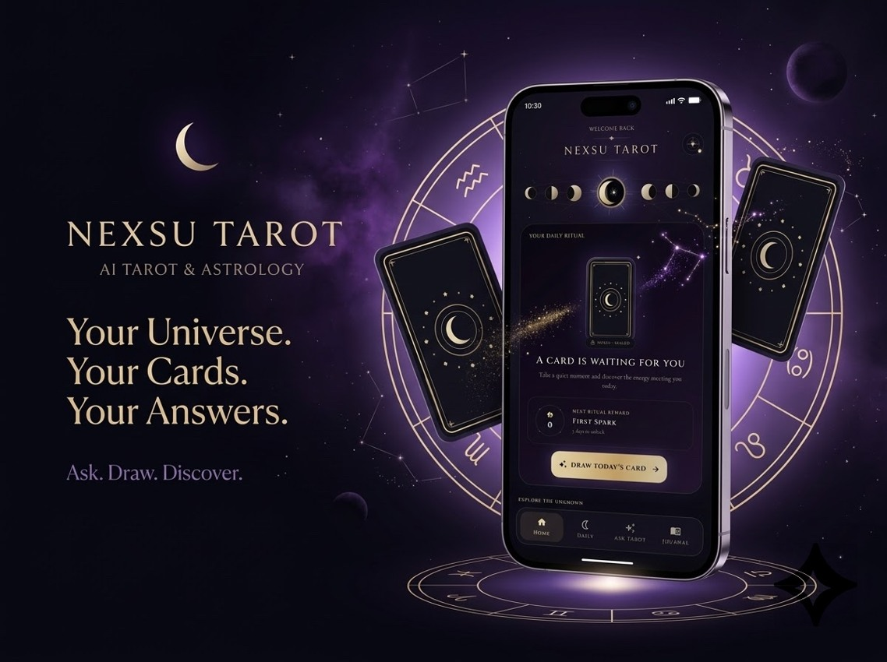

 

**3+ years in mobile engineering** &nbsp; · &nbsp; **Contributed to 1M+ download products** &nbsp; · &nbsp; **Indie app creator**

 

 

## 👋 A little about me

I'm **Khiem**, a **Mobile Software Engineer** with **3+ years of professional experience** delivering Android and cross-platform apps across **fintech, digital identity, AI, IoT, and consumer technology**.

I work across **Flutter / Dart**, **native Android / Kotlin**, and **iOS integrations**, with a particular interest in **real-time systems, secure mobile experiences, and on-device intelligence**. Outside work, I independently design, build, and publish mobile products.

> **My focus:** engineering mobile experiences that feel effortless, even when the systems behind them are complex.

 

## ◈ Engineering across domains

 

## ✦ Independently shipped products

Real products, published on Google Play. **The application source code is private**; the links below lead to their public store listings.

### 01 / Nexsu AI — Your local AI workspace

**Private intelligence. Right on your device.** An offline-first mobile AI workspace exploring local language models, streaming conversations, voice interaction, and image understanding.

`Flutter` `Dart` `On-device LLM` `Offline-first` `AI Vision` `Voice AI`

**Engineering focus:** local model execution · memory-aware mobile inference · streaming responses · privacy-first UX.

**→ [Explore Nexsu AI on Google Play](https://play.google.com/store/apps/details?id=com.nexsu.offlinechat)**

 

### 02 / Nexsu Tarot — AI Tarot & Astrology

**Your universe. Your cards. Your answers.** An independently built mobile experience blending expressive Flutter interfaces, interactive Tarot, astrology, and AI-powered insights.

`Flutter` `Dart` `Firebase` `AI Features` `Play Billing` `AdMob`

**Engineering focus:** end-to-end product delivery · custom UI/UX · subscriptions and in-app purchases · analytics and monetization.

**→ [Explore Nexsu Tarot on Google Play](https://play.google.com/store/apps/details?id=com.nexsu.tarot)**

 

## ⚡ Production engineering experience

<table>
<tr><td width="25%"><b>Anfin</b> 2025 – 2026</td><td><b>Real-time fintech & trading</b> Built mobile trading features using gRPC unary/streaming, real-time orderbooks and live charts, plus secure flows involving T-OTP, biometrics, and digital signing.</td></tr>
<tr><td><b>CoolDev</b> 2024 – 2025</td><td><b>AI, drones & consumer applications</b> Contributed to production apps spanning voice AI, computer vision, DJI gimbal controls and screen mirroring, including products reaching 500K–1M+ downloads.</td></tr>
<tr><td><b>Gtel Mobile</b> 2023 – 2024</td><td><b>Digital identity & mobile SDKs</b> Developed reusable NFC/eKYC SDKs and identity verification flows across Android and Flutter, including MRZ, NFC and face recognition integrations.</td></tr>
</table>

Selected experience highlights only. Employer code and proprietary implementations are not published here.

 

## 🧰 Engineering toolkit

**Mobile & languages**

**Cloud, development & delivery**

 

| Architecture & state | Networking & streaming | Security & mobile intelligence |
| :--- | :--- | :--- |
| Clean Architecture, MVVM, BLoC, Riverpod, GetX, DI | gRPC, WebSocket, REST, real-time synchronization | NFC, eKYC, biometrics, ML Kit, AWS Rekognition, on-device LLM |

 

## 📈 GitHub activity

  

Most professional projects are maintained in private company repositories. Public GitHub activity is only a partial view of my work.

---

### Let's build something meaningful.

**Mobile engineering · Real-time experiences · On-device AI**

[**Email me**](mailto:skhiem17022002@gmail.com) · [**GitHub**](https://github.com/KhiemPham1702) · [**Nexsu AI**](https://play.google.com/store/apps/details?id=com.nexsu.offlinechat) · [**Nexsu Tarot**](https://play.google.com/store/apps/details?id=com.nexsu.tarot)

Designed with care · © Khiem Pham

